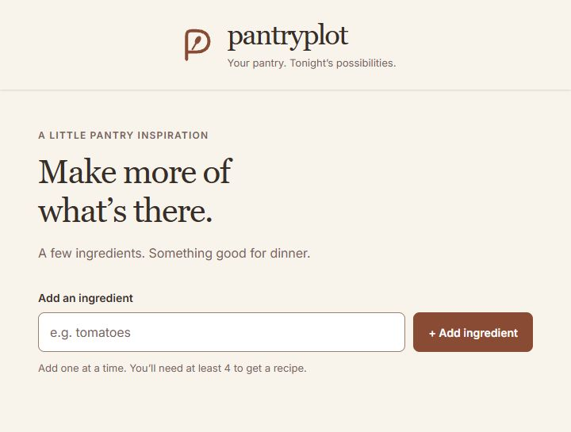
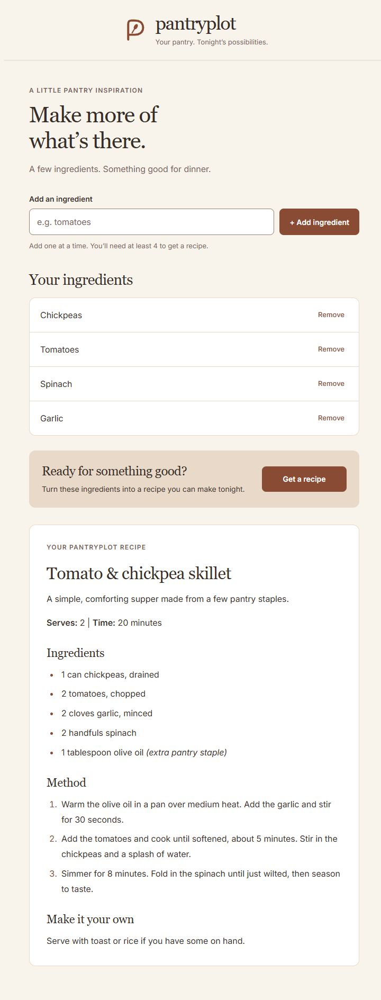
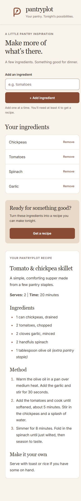

# Pantryplot

**Your pantry. Tonight's possibilities.**

An ingredient-based recipe app built with React and a small Node.js API. Add what you have, request a recipe, and read the result in a calm Oat & Terracotta interface.



## Features

- Add and remove ingredients with trimmed-input validation and case-insensitive duplicate prevention.
- Request a recipe after adding at least four ingredients.
- See loading feedback, clear errors and a retry option; the previous recipe stays visible if a later request fails.
- Read generated recipes as Markdown with headings, ingredient lists and numbered steps.
- Use a responsive interface with visible labels, linked validation messages and keyboard-focus styles.

<details>
<summary>View full desktop and mobile screens</summary>

### Desktop



### Mobile



The recipe shown in these screenshots is sample content used to test the interface.

</details>

## Stack

React 19, JavaScript, Vite, CSS, Node.js 24, Groq and react-markdown.

The API uses the built-in Request, Response and fetch APIs, with a small HTTP adapter for local development. It does not require Express, a provider SDK or an environment-variable package.

## Run locally

### Requirements

- Node.js 24 and npm.
- A Groq API key from the [Groq console](https://console.groq.com/keys).

### Setup

From the project folder:

```sh
npm ci
```

Copy the example configuration and add your own key to `.env.local`.

PowerShell:

```powershell
Copy-Item .env.example .env.local
```

macOS or Linux:

```sh
cp .env.example .env.local
```

The configuration contains one server-only variable:

```dotenv
GROQ_API_KEY=your_groq_api_key_here
```

If `.env.local` already exists, edit it rather than replacing it. Do not use a `VITE_` prefix: the credential belongs on the server and must never be sent to the browser.

### Start the app

In one terminal, start the recipe API:

```sh
npm run server
```

In a second terminal, start Vite:

```sh
npm run dev
```

Open the Local URL printed by Vite. The API listens on `127.0.0.1:3001`. Restart `npm run server` after changing `.env.local`.

The configured Groq model is `openai/gpt-oss-120b`. Provider availability and account limits apply; see the [rate-limit documentation](https://console.groq.com/docs/rate-limits).

## How it works

1. `Main.jsx` owns the ingredient list, validation, loading, recipe and error state.
2. `IngredientsList.jsx` receives the list and callbacks through props. Its button calls the recipe handler in `Main`.
3. `src/ai.js` posts the ingredient array to `/api/recipe`.
4. During development, Vite proxies that request to the local Node server.
5. `server/handler.js` validates the input and calls Groq using the private environment variable. Locally it runs through `server/index.js`; on Vercel it runs through `api/index.js`.
6. `Recipe.jsx` renders the returned Markdown and scrolls the recipe into view.

The server accepts 4 to 30 ingredients, with a maximum of 100 characters per ingredient. Recipe text uses ordinary Markdown; table rendering is not enabled.

## Project structure

```text
Pantryplot/
  docs/images/          README screenshots
  public/              Pantryplot SVG logo and favicon
  api/index.js         Vercel function entry point
  server/
    handler.js         Shared input validation and provider request
    index.js           Local HTTP server
  test/api.test.js     API checks using Node's built-in test runner
  src/
    components/
      Header.jsx
      Main.jsx
      IngredientsList.jsx
      Recipe.jsx
    App.jsx
    ai.js
    index.css
    index.jsx
  .env.example         Safe configuration template
  index.html
  package.json
  package-lock.json
  vite.config.js
  vercel.json          Frontend build and API routing
```

## Design

The spoon monogram, Georgia headings and Inter body text give Pantryplot its own identity. Palette values are CSS variables in `src/index.css`.

| Role | Colour |
| --- | --- |
| Oat background | `#F8F3EB` |
| White surfaces | `#FFFFFF` |
| Soft beige | `#E9D9C8` |
| Terracotta accent | `#B97859` |
| Deep-clay buttons and focus | `#8A4B35` |
| Main text | `#382E29` |

The main buttons share `.button-primary`. Controls are at least 44 pixels tall, long ingredient names wrap safely, and hover transitions respect reduced-motion preferences.

## Validation

```sh
npm run lint
npm test
npm run build
```

API tests use mocked provider responses and cover hosted origins, input limits, success, rate limits, credential failures and timeouts. They do not consume provider quota. The interface has been checked at 320, 375, 545, 768 and 1280 pixels wide. Input validation, removal, loading, success, failure and retry flows were checked with controlled local responses. The screenshots use a sample recipe rather than a recorded live provider response.

## Deploy on Vercel

The React frontend and recipe API run in one Vercel project and share a domain. A Vercel function runs the shared API handler when a request arrives; it does not start the local HTTP listener.

1. Import this GitHub repository into your own Vercel Hobby account.
2. Use the repository root, the Vite preset and Node.js 24.x. `vercel.json` specifies `npm ci`, `npm run build` and the `dist` output folder.
3. Add `GROQ_API_KEY` as a server-side environment variable for Production. Add it to Preview only if you want recipe generation on your own preview deployments. Never prefix the key with `VITE_` or put it in `vercel.json`.
4. Leave Vercel's system environment variables enabled. The handler allows the exact production, deployment and branch addresses supplied by Vercel. For an additional custom domain, set `APP_ORIGIN` to its complete HTTPS origin, without a trailing slash.
5. Before sharing the public demo, configure a Vercel Firewall rate-limit rule for `POST /api/recipe`: start with 5 requests per minute per IP and block requests above that limit. Check the provider account's quota too. The origin check discourages cross-site browser requests; it is not authentication and cannot protect the quota by itself.
6. Deploy, open `/api/health`, then test recipe success, loading, failure and retry in the public app. The health response reports whether a key is configured, not whether the provider will accept it.

The function has a 60-second hosting limit and a 30-second provider timeout. The API accepts JSON bodies up to 16 KiB and limits recipes to 2,048 output tokens. Per-request limits do not replace a request-rate limit.

Vercel Hobby is for personal, non-commercial projects and has usage limits. See the official [Hobby plan](https://vercel.com/docs/plans/hobby), [Node.js functions](https://vercel.com/docs/functions/runtimes/node-js) and [firewall rate-limit documentation](https://vercel.com/docs/vercel-firewall/vercel-waf/rate-limiting).

## Current limitations

- Ingredients and recipes are stored in React state and reset on refresh.
- Recipe generation depends on the configured provider key, model availability and account quota.
- GitHub Pages can host static assets but cannot run the recipe API. Use the complete Vercel deployment for the working demo.

`.env.local`, dependencies and generated build output are excluded from version control. Keep your actual API key private.
